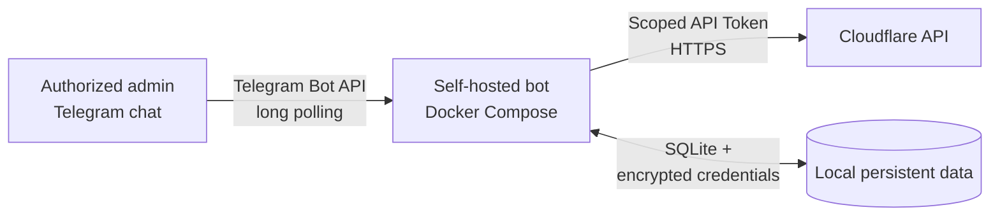

<p align="center">
  
</p>

<div align="center">

# Cloudflare Telegram Manager

**A self-hosted Telegram control panel for Cloudflare DNS, zones, and security operations.**

[](CHANGELOG.md)
[](Dockerfile)
[](docker-compose.yml)
[](https://github.com/Net-spoof/cloudflare-telegram-manager/actions/workflows/tests.yml)
[](#license)

**[🇮🇷 راهنمای فارسی](README_FA.md)** &nbsp;·&nbsp; **[🇬🇧 English documentation](README_EN.md)** &nbsp;·&nbsp; **[📋 Changelog](CHANGELOG.md)**

</div>

---

## Overview

**Cloudflare Telegram Manager** brings essential Cloudflare account and zone administration into an administrator-restricted Telegram bot. Built for self-hosting, it provides a streamlined way to inspect zones, manage DNS records, and perform selected security or cache operations without repeatedly opening the Cloudflare dashboard.

The Telegram interface is in Persian. Both Persian and English installation and operations guides are included.

## Features at a glance

| Area | Capabilities |
|:---|:---|
| **Cloudflare accounts** | Multiple accounts, active-account selection, connectivity checks, token rotation and disconnection |
| **DNS management** | List, search, create, edit and delete records; BIND import/export; 21 supported record types |
| **Zones & settings** | Zone information, selected SSL/TLS, HTTPS and network controls |
| **Cache & DNSSEC** | Cache purging and DNSSEC controls, with confirmation for high-impact operations |
| **Access control** | Numeric Telegram administrator allowlist; private-chat credential entry |
| **Secrets & persistence** | Fernet-encrypted Cloudflare tokens; persistent SQLite data; backups during installation updates |
| **Operations** | Docker Compose, built-in onboarding, safe diagnostics and offline regression tests |

> Available Cloudflare actions depend on the permissions and zone resources granted to each API token. This tool does not bypass Cloudflare permission checks.

## Languages

The bot interface supports **Persian 🇮🇷, English 🇬🇧, and Russian 🇷🇺**.

Send `/language` or select **Language** in the main menu, then choose a language with the inline buttons. Each authorized administrator's selection is saved in the existing SQLite database and restored after a restart. The main screen, Cloudflare account workflows, DNS menus, help, settings and confirmation messages follow that choice. The Telegram command menu is updated when you switch languages.

## Quick start

**Recommended:** Ubuntu VPS with root/sudo access, Python 3, Git and outbound HTTPS. The installer can install Docker/Compose when missing.

```bash
sudo apt-get update
sudo apt-get install -y git python3 ca-certificates
sudo git clone https://github.com/mahxray/cloudflare-telegram-manager.git /opt/cloudflare-telegram-manager
cd /opt/cloudflare-telegram-manager
sudo bash install.sh
```

On first launch, the installer requests your **Telegram Bot Token** and **numeric administrator ID(s)**, creates a private `.env` with a new encryption key, builds the Docker image and starts the service.

**Verify installation:**

```bash
cd /opt/cloudflare-telegram-manager
sudo docker compose ps
sudo bash diagnose.sh
```

In your Telegram bot's private chat, send `/start` and open **👤 حساب‌های Cloudflare → ➕ افزودن حساب جدید**. Create a scoped API Token from [Cloudflare's API Token dashboard](https://dash.cloudflare.com/profile/api-tokens) and follow the in-bot connection guide.

**Upgrading an existing installation?** Preserve its `.env`, `ENCRYPTION_KEY`, and `data/` directory. See [upgrade instructions](README_EN.md#upgrading-without-losing-data) before pulling or replacing files.

## Bot commands

| Command | Description |
|---|---|
| `/start`, `/menu` | Open the main dashboard |
| `/accounts` | Manage connected Cloudflare accounts |
| `/about` | Developer, repository and Telegram channel |
| `/help` | Show bot help |
| `/cancel` | Cancel the current input |

## Architecture



The bot uses **long polling**. No public webhook URL or inbound port is required for normal operation. Outbound network access to Telegram and Cloudflare is required.

## Documentation

| | فارسی | English |
|:---|:---|:---|
| Full installation & configuration | [راهنمای نصب و راه‌اندازی](README_FA.md#install) | [Install and configure](README_EN.md#installation-on-ubuntu) |
| BotFather & admin access | [ساخت ربات](README_FA.md#botfather) | [Create a bot](README_EN.md#creating-your-telegram-bot) |
| API Token & Account ID | [اتصال حساب Cloudflare](README_FA.md#cloudflare) | [Connect Cloudflare](README_EN.md#connecting-a-cloudflare-account) |
| Update and backups | [به‌روزرسانی](README_FA.md#upgrade) | [Upgrade safely](README_EN.md#upgrading-without-losing-data) |
| Troubleshooting | [رفع خطاها](README_FA.md#troubleshooting) | [Troubleshooting](README_EN.md#troubleshooting) |

## Development & verification

Run local regression tests:

```bash
python3 test_auth.py
python3 test_account_connection.py
python3 test_callback_encoding.py
python3 test_interface.py
python3 test_account_commands.py
python3 test_command_menu.py
python3 test_i18n.py
```

These tests run offline; they do not verify a live Telegram session or a real Cloudflare account.

## Security considerations

- **Never commit** `.env`, `data/`, `backups/`, Telegram tokens, Cloudflare tokens, encryption keys or unredacted logs.
- Prefer **least-privilege Cloudflare API tokens** with access limited to the necessary zones; do not use a Global API Key.
- Keep the **original `ENCRYPTION_KEY`** when upgrading. Saved token ciphertext cannot be decrypted with a different key.
- Export DNS records and verify registrar-side DS records before high-impact DNSSEC changes.
- Treat this as an **unofficial tool**. Its offline build tests do not substitute for a live deployment and permissions review.

## License

No open-source license has been declared in this repository yet. Unless a license is added, standard copyright restrictions apply. Contributions and reuse should respect the rights of the project owner.

---

<div align="center">

**Built for operators who prefer a lightweight, self-hosted workflow.**

[Get started in Persian](README_FA.md) · [Read the English guide](README_EN.md) · [View changes](CHANGELOG.md)

</div>
